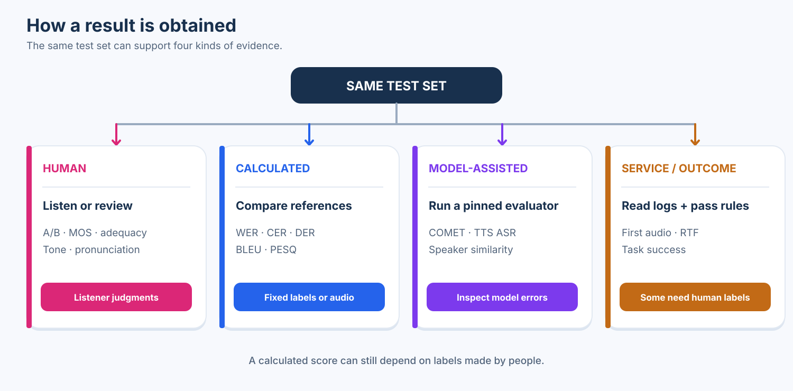
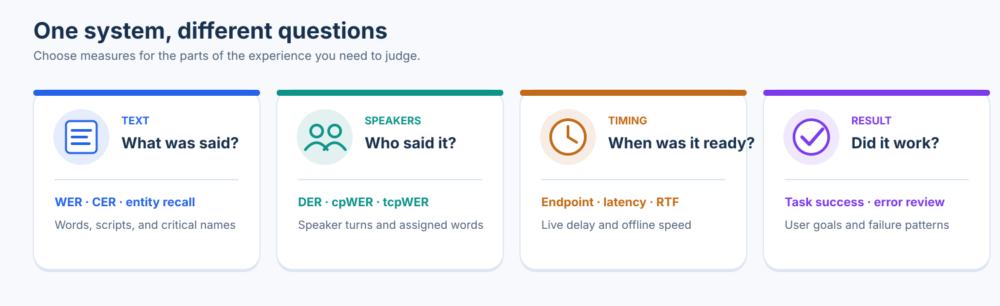
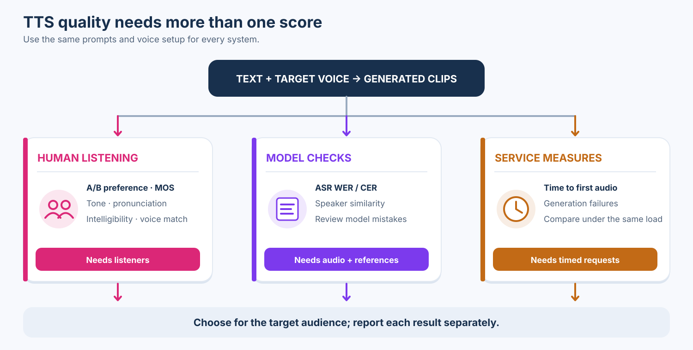
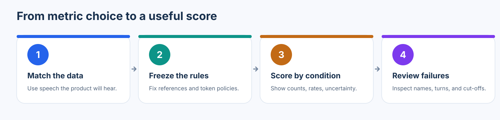

# Speech evaluation methods

Choose speech metrics by the output you need to judge.
This guide builds on the [Singapore and Southeast Asian automatic speech recognition (ASR) dataset survey](https://github.com/darren236/singapore-asr-datasets).

## Map

Six branches group metrics by task, including text-to-speech (TTS). The footer gives a short evaluation checklist.
The included scorer computes word and character error rates.


## Choose metrics

Use a primary metric for the task, then add measures for failures that matter to users.
A *reference* is the expected transcript or label; a *prediction* is the system output.
“Standard” and “common” describe use **within that task**.

| Task | Start with | Add when needed |
| --- | --- | --- |
| English ASR | **Word error rate (WER):** word errors per reference word; standard. | Counts of missed, added, and changed words; check important names. |
| Mandarin ASR | **Character error rate (CER):** character errors per reference character; common. | WER if you state how the text is split into words. |
| Mixed-script ASR | CER + **mixed-unit error rate:** count Han characters and English words. | English WER; review language changes. |
| Speaker diarization (who spoke when) | **Diarization error rate (DER):** wrong speaker time; standard. | Break out missed, false, and wrong-speaker time. |
| Multi-speaker transcript | **cpWER:** speaker-assigned word errors; common. | **tcpWER:** also checks timing; DER checks speaker turns. |
| Speech detection | Missed speech + **false alarms** (silence marked as speech). | **Endpoint delay:** time after speech ends; count early cut-offs. |
| Live voice system | **Task success:** share of user goals completed. | Final WER, early cut-offs, and time to first and final response. |
| Offline processing | WER or CER + **real-time factor (RTF):** processing time ÷ audio duration. | Compare accuracy and speed by recording type. |
| Speech translation | **BLEU:** word overlap; **chrF:** character overlap. | Human meaning check; **COMET:** model-based quality. |
| Text-to-speech (TTS) | **Human:** blind listener preference or **mean opinion score (MOS):** average rating of a named quality. | **Calculated:** speech-to-text errors; **operational:** time to first audio. Review tone, pronunciation, and voice match. |
| Cleaned-up speech | Listener rating of quality and intelligibility. | **PESQ:** telephone/codec quality when its test conditions fit. |

### Evidence types

| Type | What is needed | Examples |
| --- | --- | --- |
| **Human judgment** | People listen or review outputs against a rubric. | TTS preference and MOS; translation meaning checks. |
| **Calculated score** | Recordings, predictions, and fixed reference labels or audio. People may need to create the references. | WER, CER, DER, BLEU, PESQ. |
| **Model-assisted check** | A pinned evaluation model; inspect its mistakes. | COMET; TTS speech-to-text errors and speaker similarity. |
| **Service or outcome measure** | Timing logs or defined success labels. Some outcomes need human review. | First-audio delay, RTF, task success. |



### Four questions

The same speech system can need different measures for text, speakers, speed, and results.



## Transcript accuracy

Use the same references, token rules, and normalization for every model.
For edit rates, **(substitutions + deletions + insertions) / reference units**.
Lower is better. Insertions can push WER or CER above 100%.

| Metric | Use | Small example |
| --- | --- | --- |
| **WER** · word error rate | Main word-based ASR score. | `meet at Bedok` → `meet Bedok`: 1 deletion / 3 words = **33.3%**. |
| **CER** · character error rate | Mandarin and other character-based or mixed-script text. | `Bedok` → `Bedo`: 1 deletion / 5 characters = **20%**. |
| Sentence error rate | Exact commands; length-sensitive diagnostic. | 1 wrong utterance in 2 = **50%**. |
| Entity recall | Names, addresses, brands, or amounts with labeled entities. | 2 of 3 required entities correct = **66.7%**. |
| Mixed-unit error rate | Code-switched text; publish token rules. | `我去 Bedok` → `我到 Bedok`: 1 / 3 Han-character or English-word units = **33.3%**. |
| **MER** · match error rate | Less common view of edit alignment. | `hello` → `hello now again`: 2 errors / (1 match + 2 errors) = **66.7%**. |
| **WIL** · word information lost | Less common view of words recovered. | Same example: 1 − (1/1 × 1/3) = **66.7%**. |
| Edit counts | Explain whether text was added, missed, or changed. | `okay lah` → `okay`: 1 deletion; reverse it: 1 insertion. |

**Normalization changes the question.** `okay lah` → `okay` is **50% WER**
when `lah` counts. Removing `lah` from both sides makes it **0%**.
Choose a policy that matches the product and save it with each score.

This scorer splits words on whitespace and counts non-space Unicode code points for CER.
For a corpus, it adds edit counts before dividing by reference units.
Publish the unit rule for Mandarin and code-switched speech.
The [ASR guide](docs/metrics.md) covers normalization, empty references, and alignment details.

## Speakers

Word accuracy alone cannot show who spoke. Speaker metrics need time or speaker labels.

| Metric | Use | Small example |
| --- | --- | --- |
| **DER** · diarization error rate | Standard speaker-time score. | 3 s missed, false, or misassigned / 10 s reference = **30%**. |
| **cpWER** | Speaker-attributed word accuracy. | Alice `turn left`, Bob `stop`; output `turn left`, `start`: 1 / 3 = **33.3%**. |
| **tcpWER** | Speaker words with a time constraint. | A correct `stop` placed 20 s late can pass cpWER and fail tcpWER. |

For DER, state the scored region, boundary collar, overlap rule, and error breakdown.
For cpWER and tcpWER, use a defined matching protocol such as [MeetEval](https://github.com/fgnt/meeteval).

## Detection and speed

These measures capture missed speech and response time.

| Metric | Use | Small example |
| --- | --- | --- |
| Miss + false-alarm rates | Speech detection; separate denominators. | Miss 2/10 speech seconds; flag 1/10 silence seconds: **20%**, **10%**. |
| Endpoint delay + cut-offs | End-of-turn handling. | Speech ends at 2.0 s; final text at 2.6 s: **0.6 s delay**. One early cut-off in 20 turns = **5%**. |
| Streaming latency | Time to first, stable, and final text. | Text appears at 0.7 s, stabilizes at 1.8 s, finalizes at 3.0 s: report **all three**. |
| **RTF** · real-time factor | Offline throughput on stated hardware. | A 10 s clip takes 2 s to process: **RTF = 0.2**. |

For latency, state the clock origin, device, network, chunk size, and revision policy.
RTF does not include queue or endpoint delay.

## Translation

Automatic scores compare translations, but meaning can survive different wording.
Use human review for names, numbers, negation, and other critical meaning.

| Metric | Use | Small example |
| --- | --- | --- |
| **BLEU** | Common corpus token-overlap score. | `A train is coming shortly` keeps the meaning of `The train is arriving soon` with fewer shared words. |
| **chrF** | Character-overlap score, useful across scripts and inflections. | `Bedo` shares many characters with `Bedok`, despite losing the final `k`. |
| **COMET** | Learned quality score with a pinned model. | Source `左转`, reference `Turn left`, output `Turn right`: run the model and inspect the reversal. |
| Human adequacy | Check whether the message is correct. | A reviewer marks `Turn right` for `左转` as incorrect under a stated rubric. |

Use [SacreBLEU](https://github.com/mjpost/sacreBLEU) to record BLEU/chrF settings.
COMET scores need a model version and cannot be calculated from this text example alone.

## Text-to-speech (TTS)

Use **human ratings** for how speech sounds, **calculated checks** for specific errors,
and **service measures** for speed and reliability.
The calculated checks need generated audio and references; some references require human labeling.



### Human listening

People must hear the clips and make these judgments.
Use the same prompts and playback conditions for each system.

| Metric | Use | Small example |
| --- | --- | --- |
| Blind A/B preference | Which of two hidden systems sounds better for the same text? | 18 of 30 listeners choose A for a prompt set: **60% prefer A**. |
| **MOS** · mean opinion score | Rate one named quality, such as naturalness, on a fixed scale. | Naturalness ratings 4, 4, 3, 5, 4 on a 1–5 scale give **4.0/5**. |
| Pronunciation rating | Listen for names, numbers, abbreviations, and context-dependent words. | Reviewers accept 8 of 10 marked terms: **80% correct**. |
| Word intelligibility | Ask listeners to repeat what they heard. | They repeat 90 of 100 target words correctly: **90%**. |
| Voice match rating | For voice cloning, compare with an authorized reference speaker. | Reviewers judge 16 of 20 clips as matching: **80%** under that rubric. |

### What listeners check

- **Words:** Are names, local terms, numbers, and abbreviations pronounced correctly? Is any text skipped or invented?
- **Prosody:** Do stress, pitch, rhythm, and pauses fit the sentence? Does a question sound like a question?
- **Tone:** Does the emotion and level of warmth fit the message, without sounding flat or exaggerated?
- **Voice:** Is the accent appropriate and stable? For cloning, does identity stay close to the reference?
- **Sound:** Are there clicks, distortion, unnatural breaths, abrupt joins, or uneven loudness?
- **Long passages:** Does the voice stay consistent and easy to listen to over time?

For example, read “Turn left at Bedok” aloud. A listener checks both *Bedok* and emphasis on *left*;
a transcript-based score may miss awkward stress or an unsuitable tone.
Blind model names, randomize clip order, use listeners familiar with the language or accent,
and report the exact question, scale, prompt set, listener count, playback setup, and uncertainty.

### Calculated checks

These can be computed with a scorer or model after the audio and reference are available.
Speech-to-text and speaker-similarity checks depend on an evaluation model.
They flag likely problems; inspect samples before treating a score as proof of listener quality.

| Metric | Use | Small example |
| --- | --- | --- |
| Speech-to-text WER/CER | Transcribe generated audio with a recognizer; compare with the input words or characters. | Prompt `turn left`, recognizer hears `turn`: **50% WER**. The recognizer can also be wrong. |
| Speaker similarity | For cloning, compare generated and reference voices with the same speaker-embedding model. | Clip A scores **0.82**, B **0.70** against one reference; higher is closer *under that model*. |

### Service measures

These come from request logs and timed generation runs. They matter for live products.

| Measure | Use | Small example |
| --- | --- | --- |
| Time to first audio | Delay before playback can begin. | Request at 0.0 s; first playable audio at 0.4 s: **0.4 s**. |
| Generation failure rate | Empty, failed, or unusable outputs. | 3 failures in 100 requests = **3%**. |

### Leaderboards

| Board | Evidence | Check before using a rank |
| --- | --- | --- |
| [TTS Arena](https://huggingface.co/spaces/TTS-AGI/TTS-Arena-V2) | **Human:** blind listening preference. | Language coverage, vote counts, and rating uncertainty. |
| [Artificial Analysis Speech Arena](https://artificialanalysis.ai/text-to-speech/leaderboard) | **Human:** blind preference and pronunciation judgments; speed is measured separately. | Voice, language, category, vote counts, and uncertainty. |
| [Hugging Face Open TTS](https://huggingface.co/spaces/hf-audio/open_tts_leaderboard) | **Calculated:** speech-to-text error, speaker similarity, and speed. | These do not directly measure naturalness, tone, or listener preference. |

Use rankings to shortlist systems, then listen to **your own prompts** with the target audience.
Keep preference, pronunciation, voice match, and speed as separate results; one rank cannot cover all four.

## Audio enhancement

Cleaned-up speech needs a different listening question from TTS.
**Human:** rate listening quality and whether words remain understandable.
**Calculated:** use PESQ only when its telephone/codec conditions fit.

| Metric | Use | Small example |
| --- | --- | --- |
| **PESQ** | Objective telephone/codec quality under its specified conditions. | Compare clean and degraded recordings with a conforming tool. Audio is needed for a score. |

PESQ is not a general TTS naturalness score.

## Task outcomes

**Task success** measures whether the voice workflow achieves its goal.
If 17 of 20 bookings are correct and need no repair, success is **85%**.
Define the pass rule and show failures by scenario.
Use WER and latency to help explain failures.

The [other speech tasks guide](docs/other-tasks.md) links to method sources and limits.

## Run the scorer

Requires Python 3.10+ and no runtime packages.

```bash
PYTHONPATH=src python3 -m speech_eval.cli examples/references.jsonl examples/hypotheses.jsonl --output report.json
```

- Reference JSONL: `id`, `reference`, and optional `group`.
- Prediction JSONL: matching `id` values and `hypothesis`.
- Missing, extra, or duplicate IDs stop scoring.

The report gives corpus WER and CER, plus scores by group.
Rates are fractions: `0.20` means 20%.

The default `basic` policy folds case and Unicode form, removes punctuation, and normalizes spaces.
Use `--normalization strict` to keep the original text. Save the policy with each score.

The scorer covers **WER and CER only**. Other metrics in this guide are explained, not computed.
If `pip` is available, `pip install -e .` also adds the `speech-eval` command.

## Evaluation checklist



1. Match the test set to the speech your product will hear.
2. Record its version, references, rights, speakers, and possible training overlap.
3. Freeze model settings, manifests, normalization, and tokenization.
4. Score every ID. Report counts and rates by dataset and condition.
5. Review local names, particles, language switches, noise, and speaker turns.
6. Compare systems on paired recordings; account for shared speakers and calls.

See the [evaluation protocol](docs/protocol.md) for Singapore dataset choices and scorecards.
The [worked examples](docs/examples.md) show each calculation in more detail.

## Sources

The scorer uses synthetic examples. It does not download or redistribute source-dataset material.
Dataset rights and reference quality are in the [survey](https://github.com/darren236/singapore-asr-datasets).

Definitions draw on [JiWER](https://github.com/jitsi/jiwer),
[MeetEval](https://github.com/fgnt/meeteval),
[SacreBLEU](https://github.com/mjpost/sacreBLEU), and
[ITU-T P.800](https://www.itu.int/rec/T-REC-P.800-199608-I/en).
The guides link to sources for specific methods.
