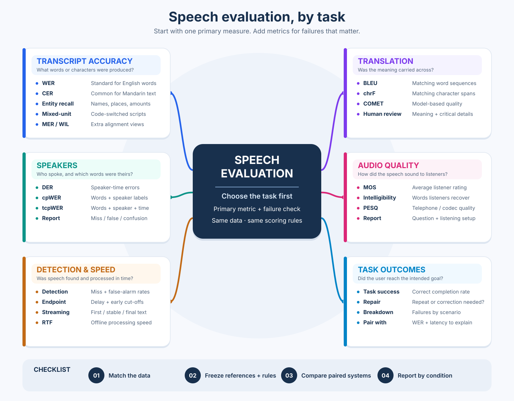

# Speech evaluation methods

A guide to choosing speech metrics, plus a small ASR scorer.
It builds on the [Singapore and Southeast Asian ASR dataset survey](https://github.com/darren236/singapore-asr-datasets).

Start with what you need to judge: words, speakers, timing, translation, audio quality, or task success.
Then choose a metric and a matching test set.

## Map

The map groups metrics by use. The included scorer implements **WER and CER**.



## Recommended metrics

“Standard” and “common” describe use **within that task**, not a ranking across tasks.
Lower is better for errors and latency. Higher is better for accuracy and quality.

| Category | Recommended set | Why this set |
| --- | --- | --- |
| English ASR | **WER** (standard) + edit counts; add entity recall | Overall words plus critical names. |
| Mandarin ASR | **CER** (common) + declared word segmentation if using WER | Avoids hidden tokenization effects. |
| Mixed-script ASR | CER + declared mixed-unit rate + switch review | Shows errors across scripts. |
| Speaker diarization | **DER** (standard) + error breakdown | Shows both the total and its causes. |
| Multi-speaker transcript | **cpWER** (common) or **tcpWER** + DER | Checks words, speakers, and timing. |
| Speech detection | Miss/false-alarm rates (common) + endpoint delay | Catches lost speech and slow endings. |
| Live voice system | Final WER + latency + task success | Balances accuracy, speed, and outcome. |
| Offline processing | **RTF** (common) + WER/CER | Balances throughput and accuracy. |
| Speech translation | BLEU or chrF + human adequacy; COMET when supported | Checks overlap and meaning. |
| Speech synthesis or enhancement | MOS listening test + intelligibility | Checks perceived quality and clarity. |

Read the [ASR metrics](docs/metrics.md), [other speech tasks](docs/other-tasks.md),
and [evaluation protocol](docs/protocol.md) for definitions and limits.
See [examples for every metric](docs/examples.md) for small worked cases.

## Example

Reference: `okay lah` · prediction: `okay`.

- Count `lah`: **1 error / 2 words = 50% WER**.
- Remove `lah` during normalization: **0% WER**.

Choose one policy that matches the product. Use it for every model.

## Run the scorer

Requires Python 3.10+ and no runtime packages.

```bash
PYTHONPATH=src python3 -m speech_eval.cli examples/references.jsonl examples/hypotheses.jsonl --output report.json
```

- Reference JSONL: `id`, `reference`, and optional `group`.
- Prediction JSONL: matching `id` values and `hypothesis`.
- Missing, extra, or duplicate IDs stop scoring.

The report gives corpus WER and CER, plus scores by group.
Rates are fractions: `0.20` means 20%.

The default `basic` policy folds case and Unicode form, removes punctuation, and normalizes spaces.
Use `--normalization strict` to keep the original text. Save the policy with each score.

The scorer covers **WER and CER only**. Other metrics in this guide are explained, not computed.
If `pip` is available, `pip install -e .` also adds the `speech-eval` command.

## Checklist

1. Match the test set to the speech your product will hear.
2. Record its version, references, rights, speakers, and possible training overlap.
3. Freeze model settings, manifests, normalization, and tokenization.
4. Score every ID. Report counts and rates by dataset and condition.
5. Review local names, particles, switches, noise, and speaker turns.
6. Compare systems on paired recordings; account for shared speakers and calls.

## Sources

The scorer uses synthetic examples. It does not download or redistribute source-dataset material.
Dataset rights and reference quality are in the [survey](https://github.com/darren236/singapore-asr-datasets).

Definitions draw on [JiWER](https://github.com/jitsi/jiwer),
[MeetEval](https://github.com/fgnt/meeteval),
[SacreBLEU](https://github.com/mjpost/sacreBLEU), and
[ITU-T P.800](https://www.itu.int/rec/T-REC-P.800-199608-I/en).
The guides link to sources for specific methods.

## Contribute

```bash
PYTHONPATH=src python3 -m unittest discover -s tests -v
```

For a new metric, include its definition, text or annotation policy, worked example, and tests.
